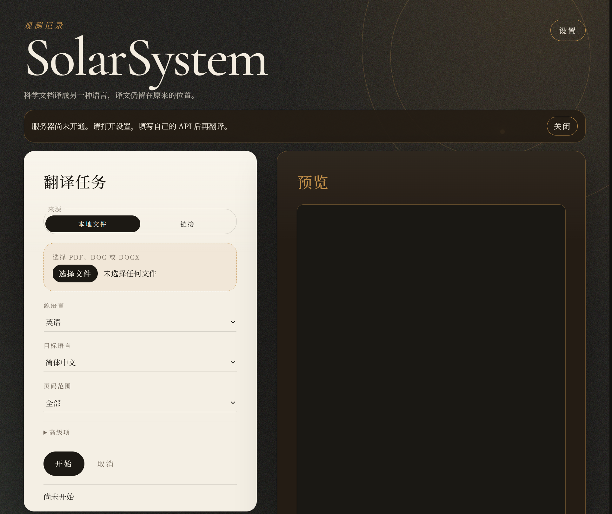
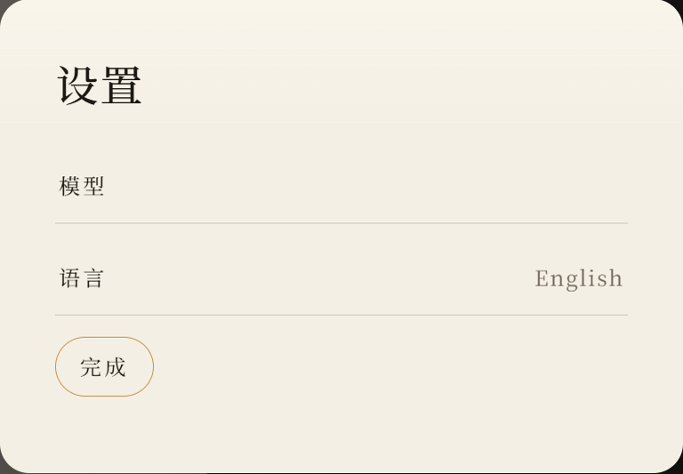
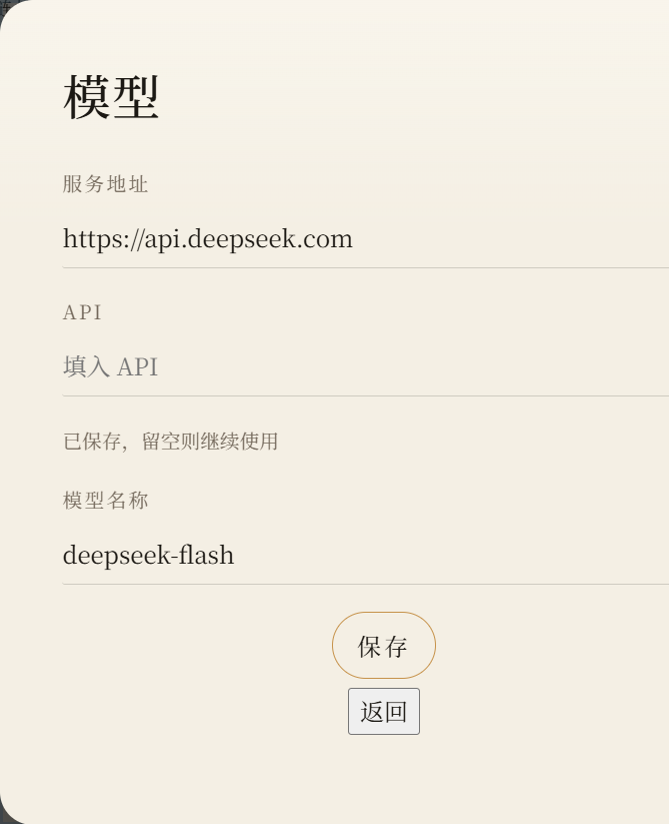

# SolarSystem

SolarSystem 把科学文献 PDF 翻译成另一种语言，并尽量把译文填回原来的位置。公式、图片、表格线、矢量图形和批注留在原处，不参加翻译。

现在还没有对外开放的翻译服务器。打开网页的人需要在设置里填写自己的 API，保存在运行网页的那台电脑上，之后用这份 API 翻译。密钥不会写进这个仓库。

## 界面

首页是夜间观测台的版式。左边提交翻译任务，右边预览原文，完成后可以下载译文和对照 PDF。顶部提示可以关闭；关闭后，这次浏览会记住，刷新不再出现。



设置里可以切换界面语言，也可以进入模型页填写翻译接口。



模型页填写服务地址、API 和模型名称。API 输入框是密码框。已经保存过时，留空再保存会继续使用原来的密钥，页面上不显示密钥本身。



## 它做什么

一份文档会走出两份 PDF：

- `文件名-mono.pdf`：译文页。正文换成目标语言，公式和图像仍在原来的位置。
- `文件名-dual.pdf`：对照页。每一页原文后面紧跟对应的译文页。

可以处理：

- 本机 PDF
- `http` 或 `https` 链接指向的 PDF
- DOC、DOCX。转换需要本机安装 LibreOffice（`soffice`）

默认从英语译成简体中文。可选语言：

| 代码 | 语言 |
| --- | --- |
| `zh` | 简体中文 |
| `zh-TW` | 繁体中文 |
| `en` | 英语 |
| `fr` | 法语 |
| `de` | 德语 |
| `ja` | 日语 |
| `ko` | 韩语 |
| `ru` | 俄语 |
| `es` | 西班牙语 |
| `it` | 意大利语 |

网页上可以选择全部页面、第一页、前五页，或自定义页码，例如 `1,3-5`。翻译进行中可以取消。同一段原文、同一种语言和同一个模型会写入本地缓存，避免重复请求。

译成中文时，程序会按原文的句读补上中文标点，并去掉汉字与英文、数字之间用来充当标点的空格。英文短语内部的空格会保留，例如人名。

## 它不做什么

- 不识别扫描页。某一页如果没有原生文字，这一页会被跳过，不会从图像里辨认文字。
- 不翻译公式、图片、矢量图形和批注。旋转的文字也保持原样。
- 不在仓库里提供可用的翻译密钥。Google、Bing 的网页翻译接口也没有接入。
- 网页装在自己的电脑上，并不等于文章文字不出这台电脑。使用 DeepSeek、OpenAI 或其他在线模型时，待翻译的文字会发送给该服务商。

上传和链接下载的大小上限约为 100MB。

## 自己的 API

在网页中打开「设置 → 模型」，填写三项后点保存：

- 服务地址，例如 `https://api.deepseek.com`
- API
- 模型名称，例如 `deepseek-flash`

保存之后，点「开始」就会用这份接口翻译，不用每次再填。密钥写在运行程序的那台电脑上，文件名是 `solarsystem.local.json`。这个文件已经在 `.gitignore` 里，正常提交不会把它带进仓库。

也可以用环境变量，环境变量优先于本机文件：

- `SOLARSYSTEM_BASE_URL`
- `SOLARSYSTEM_API_KEY`
- `SOLARSYSTEM_MODEL`

这台电脑上的网页共用一份已保存的 API。后保存的内容会替换先前的内容。

## 安装与启动

需要 Python 3.11 或更高版本。

```powershell
python -m venv .venv
.\.venv\Scripts\python.exe -m pip install -e ".[dev]"
.\.venv\Scripts\python.exe -m solarsystem --web --port 7474
```

浏览器打开 `http://127.0.0.1:7474`。

命令行直接翻译一份 PDF：

```powershell
.\.venv\Scripts\solarsystem.exe paper.pdf --service openai_compatible --lang-in en --lang-out zh
```

命令行如果不写 `--service openai_compatible`，默认使用 `echo`。`echo` 只把原文写回去，用来测试排版，不会调用模型。网页上的「开始」默认使用已保存的兼容接口。

常用参数：

| 参数 | 作用 |
| --- | --- |
| `--pages 1,3-5` | 只处理这些页 |
| `--output 目录` | 指定结果目录 |
| `--thread 4` | 同时翻译的段落数 |
| `--ignore-cache` | 不使用已缓存的译文 |
| `--prompt 文件` | 在翻译提示词后面追加一段说明 |
| `--host` `--port` | 网页监听地址和端口，默认 `127.0.0.1:7474` |

Python 里可以调用 `translate` 或 `translate_stream`：

```python
from solarsystem import translate

translate(["paper.pdf"], service="openai_compatible", lang_in="en", lang_out="zh")
```

## 程序怎样处理一页

1. 用 PyMuPDF 读取页面上的原生文字，不调用神经网络排版。
2. 把公式段落留下来，其余文字按栏、标题、作者和侧栏分成区域。
3. 把需要翻译的段落发给所选模型。形如 `{{v0}}` 的公式占位符必须原样返回。
4. 擦掉原来的正文，再把译文按区域重新排进去。中文优先使用系统里的 Noto Sans SC。
5. 写出译文 PDF 和对照 PDF。

## 目录

| 路径 | 内容 |
| --- | --- |
| `src/solarsystem/` | 读取、翻译、排版、缓存和网页 |
| `web/` | 页面和脚本 |
| `styles/theme.css` | 外观 |
| `locale/` | 中文和英文界面文字 |
| `tests/` | 测试 |
| `docs/screenshots/` | 介绍页用的界面截图 |

运行测试：

```powershell
.\.venv\Scripts\python.exe -m pytest tests -q
```
